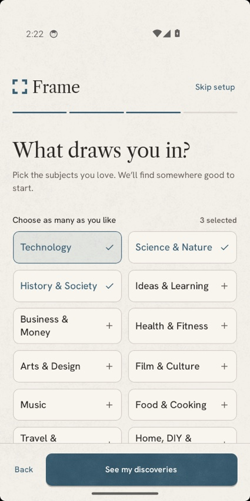
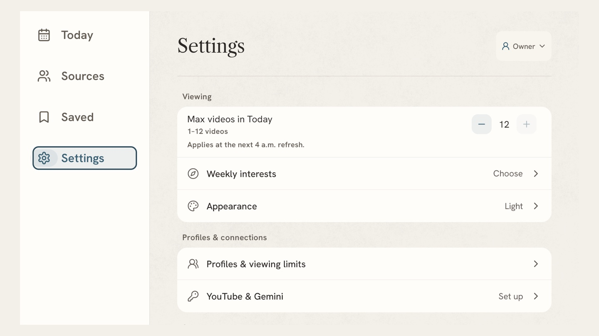

# Frame

Great videos, minus the rabbit holes. Frame gives you a small daily selection from YouTube creators you follow. Save a film for later, put a few videos in order for the evening, or stop when your session ends.

**[Download Android build 7](https://github.com/whatifqu3stion/frame/releases/download/v1.0.0-android.7/Frame-1.0.0-7.apk)** · [Release notes and checksum](https://github.com/whatifqu3stion/frame/releases/tag/v1.0.0-android.7) · [Release source](https://github.com/whatifqu3stion/frame/tree/v1.0.0-android.7)

## On your phone and TV

The same APK supports Android phones and TVs running Google TV or Android TV, including compatible Hisense models. On a phone, Frame uses bottom navigation. On TV, the main sections sit in a left rail. A visible outline follows the remote as you move between controls.

| Android phone | Android TV |
| :--- | :--- |
|  |  |
| Choosing interests during setup | Adjusting viewing preferences with the remote |

## What you can do

- **Today** brings recent videos from followed creators into a daily selection. Set a limit of 1–12 videos, with at most two per source. The next edition starts at 4 a.m. local time.
- **Sources** lets you follow a creator by channel link or @handle. Choose which creators appear in Today. Optional Gemini discovery suggests new sources based on your interests.
- **Saved and Sessions** keep individual videos and ordered playlists. Start a session when you’re ready, choose when to advance, and finish at the end of your list.
- **The viewing room** offers optional house-light dimming and tracks viewing time. On TV, use the directional pad to reach playback controls, video details and saving actions.
- **Profiles** keep libraries and viewing preferences separate. An Owner can set viewing limits and review requests for Managed profiles.

## Install and connect

1. Download the signed APK above. Install it on an Android 7.0 or later phone, or sideload it onto a compatible TV. To update an existing signed installation, install over it to keep your data.
2. In setup or **Settings → YouTube & Gemini**, enter your YouTube Data API v3 key to load videos. Add a Gemini key if you want AI-assisted discovery. You can explore setup before adding either key.
3. On TV, pair the **Google TV** phone app’s remote on the same Wi-Fi. Select a key field on the TV, paste on the phone keyboard, then choose **Verify & save**.

If your TV is already connected and authorized for Android debugging, install from the APK’s download directory:

```sh
adb -s TV_SERIAL install -r Frame-1.0.0-7.apk
```

Keys are stored in secure storage on each device and sent directly to Google for provider requests. Provider quotas and charges may apply. Set up the phone and TV separately. [Key setup and privacy](https://github.com/whatifqu3stion/frame/blob/v1.0.0-android.7/expo/docs/BYOK.md)

## Development

The app uses React Native, Expo Router, TypeScript and SQLite. From the build 7 source checkout, install dependencies and start the local web preview:

```sh
cd expo
bun install
bun run start-web
```

Open `/welcome-preview` to explore onboarding. Use `bun run start` for native development and `bun run verify` for type checking, lint and tests. [Development guide](https://github.com/whatifqu3stion/frame/blob/v1.0.0-android.7/expo/README.md) · [Android build and signing](https://github.com/whatifqu3stion/frame/blob/v1.0.0-android.7/expo/docs/ANDROID_SIDELOAD.md)
