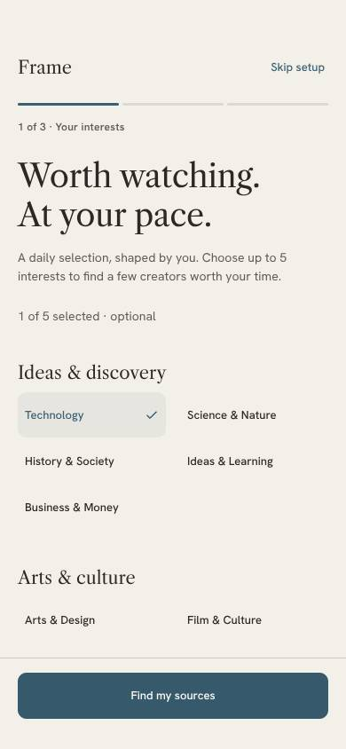

# Frame

**Great videos, minus the rabbit holes.**

Frame is a React Native app for a quieter YouTube experience: discover worthwhile creators, keep a small daily selection, and watch on your own terms.

The product question is simple: can a video app make it easier to find something worthwhile, keep it for later, and reach a satisfying stopping point?

## Earlier prototype



An October 2 onboarding prototype, rendered from Expo web at a phone-sized viewport. The current onboarding has since been rebuilt with animated research screens, an app demonstration, interest selection and a personalized video reveal. This image documents the earlier design, not the current release.

[Capture notes](docs/previews/README.md) record the source revision and demo conditions.

## The experience

- **Today:** a bounded daily selection from followed sources.
- **Sources:** creators you choose, with optional weekly suggestions.
- **Saved:** a personal collection of videos to return to.
- **Sessions:** an ordered viewing plan with an ending.
- **Profiles:** separate collections and viewing boundaries, including Owner approval for Managed profiles.
- **Viewing room:** a focused player with optional house-light transitions, viewing-time tracking and explicit next-video choices.

Today is designed to stay stable during the day rather than refill as items are handled. The selection logic uses a 4 a.m. local reset, at most 12 videos, and at most two from each source.

## Current status

**Updated November 21, 2026.** Android build 6 fixes the custom-interest onboarding crash, introduces a shorter setup with optional Why Frame screens and updates the launcher icon.

[Download the signed build 6 APK](https://github.com/whatifqu3stion/frame/releases/download/v1.0.0-android.6/Frame-1.0.0-6.apk) and install it over build 5 to keep local data. The update was tested on an Android 14 emulator from the stuck onboarding screen through to a cold start on Today with both keys blank.

TypeScript and all 506 tests passed. Lint reported zero errors and one existing warning. See the [release handoff](expo/docs/RELEASE_CANDIDATE.md) for the exact source revision, checksum and remaining device checks.

A source-level implementation or passing automated test does not establish that the native experience is ready to ship. Real-device visual, accessibility, motion, and playback checks remain part of the [acceptance plan](expo/docs/SMOKE_TEST.md).

This branch is the full-access BYOK edition: no subscription tiers or paywalls. Owners configure their own YouTube and optional Gemini keys in onboarding or Settings → YouTube & Gemini. Native keys are stored on the device using SecureStore. Gemini discovery uses the owner's provider account and may incur charges. Google account sign-in/subscription import is retired; add creators by channel link or @handle. See [BYOK setup and security](expo/docs/BYOK.md).

## Run locally

Requires Node.js and Bun:

```sh
cd expo
bun install
bun run start-web
```

Use `/welcome-preview` to review onboarding in the local web app, `bun run start` for native development, and `bun run verify` for TypeScript, lint and tests. See the [app development guide](expo/README.md) for native builds and preview limitations.

## Design decisions

Frame uses a restrained visual language, recognizable creator imagery, clear actions, and explicit endings. Its [design specification](DESIGN.md) records the component system, terminology, accessibility considerations, and rationale.

Profiles and viewing policy are separated from presentation. The daily-selection algorithm is also separate from its screen, making rules such as source limits and snoozed returns directly testable.

## Explore the repository

| Area | Start here |
| --- | --- |
| Mobile app and local development | [expo/README.md](expo/README.md) |
| Visual language and product voice | [DESIGN.md](DESIGN.md) |
| Daily-selection rules | [Today domain logic](expo/domain/today.ts) |
| Environment separation | [Environment guide](expo/docs/ENVIRONMENTS.md) |
| Native release checks | [Acceptance plan](expo/docs/SMOKE_TEST.md) |
| Backend work | [backend/](backend), [functions/](functions), [supabase/](supabase) |

**Stack:** React Native · Expo Router · TypeScript · SQLite · backend services.

Development is assisted by Rork and AI tools. The checked-in rules, tests, design decisions, and remaining acceptance work describe the project more accurately than a claim of production readiness.
